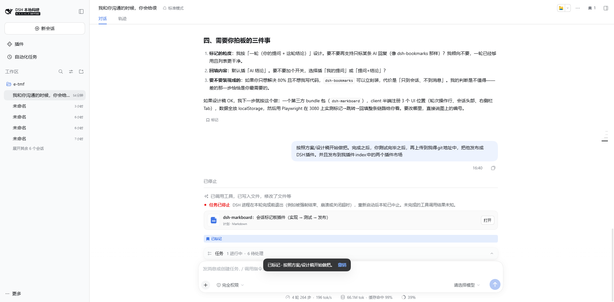
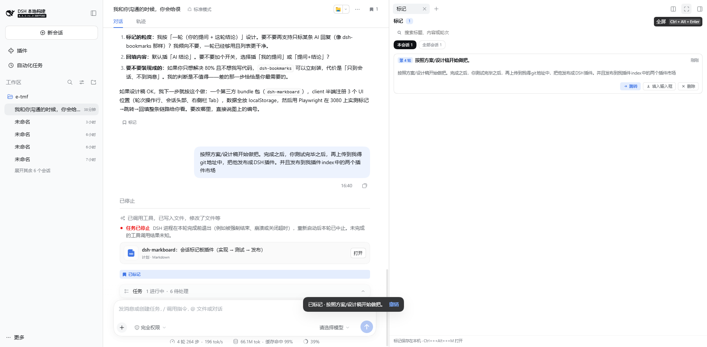
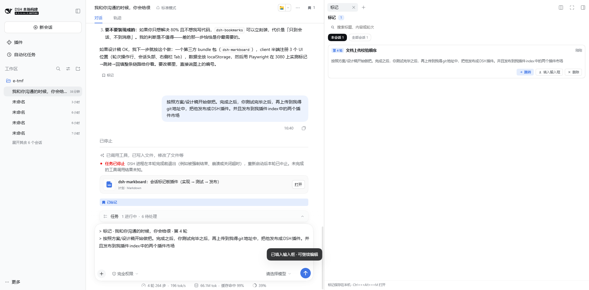
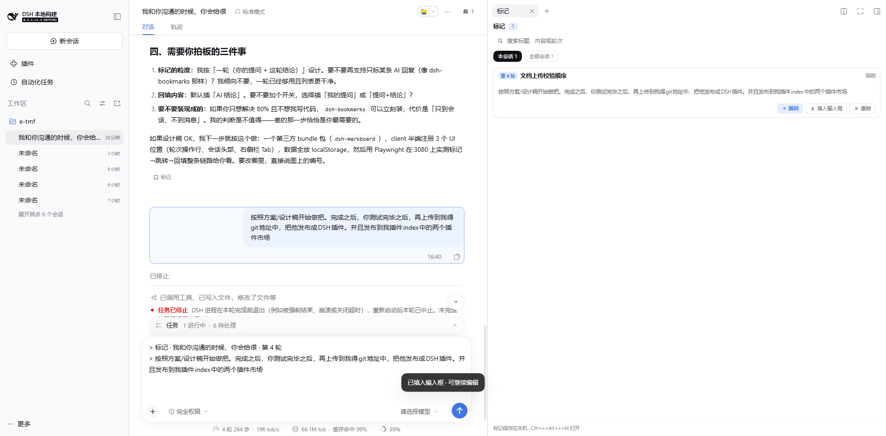

# dsh-markboard · conversation marks for DSH

[中文](./README.zh.md) | English

A **conversation markboard** for the [DeepSeek Harness](https://github.com/deepseek-ai/deepseek-harness) (DSH) Web UI: turn any conversation turn into a named task card, jump straight back to it later, or quote its answer into the composer and keep working. Marks live in your browser.

> Stop scrolling through history to find "that conclusion from earlier". Mark it once, then pick from a handful of rows.

## Screenshots

| Mark action on each turn + header count | The markboard in the right Sidebar |
|---|---|
|  |  |

| Fill the composer from a card | Jump back to the turn |
|---|---|
|  |  |

## Features

- **Mark a whole turn** — a Mark action under every completed answer records the turn (your prompt plus this turn's answer) and names it from the prompt's first sentence. Click again to remove it.
- **Header count** — the Session header shows how many turns are marked; click it to open the board.
- **Right-Sidebar page** — its own tab beside Files and Browser, with "this session" / "all sessions" scopes and search over labels, content, and turn numbers.
- **Rename and delete** — click a card's title to rename it; deletion comes with an undo.
- **Jump back** — opens the owning session and scrolls the turn into view. When that turn is outside the loaded window, history is paged in first through the kernel's exact `loadThrough(seq)`, and the landing row flashes once.
- **Fill the composer** — writes the turn's answer into the current draft as a plain-text quote (`> 标记 · session · turn N`) that you can keep editing or delete; the previous draft is restorable. A card from another session fills the composer you are already typing in, without switching sessions, and appends after any existing draft instead of replacing it.
- **Cross-tab sync** — another tab of the same origin writing marks updates this one.
- **Bilingual** copy that follows the interface language.

## Install

```sh
dsh plugin --profile web add dsh-markboard
```

Then restart `dsh web`. The plugin adds itself to the profile's bundle layer; nothing else to configure.

From a local checkout:

```sh
dsh plugin --profile web add file:/absolute/path/to/dsh-markboard
```

## Usage

1. Find the turn you want to keep and click **Mark** in the action row under the answer.
2. The header shows a count; click it (or press `Ctrl+Alt+M`) to open the markboard.
3. Each card offers **Jump** (back to the turn), **Fill composer** (quote the answer into the draft), and **Delete** (undoable).
4. Click a card's title to rename it — the label is your task name.

## Shortcut

`Ctrl+Alt+M` (`⌘+Alt+M` on macOS) toggles the board. The binding is editable under Settings → Shortcuts.

## How it works

Two halves, like any DSH surface plugin:

- **Host half** (`lib/index.js`): an empty `apply`. It only makes the package an ordinary Loader entry, which is what lets `client-modules` discover the `dsh.client` declaration in `package.json` and compose the browser half into `window.__DSH_BOOT__`.
- **Browser half** (`src/client`, built to `lib/client.js`): registers three existing extension seats plus a `ctx.markboard` service.

| Place | Seat | What it adds |
|---|---|---|
| Turn action row | `conversation.chat.turnTail` | the Mark / Marked button |
| Session header | `conversation.session.header.utilities` | the mark count entry |
| Right Sidebar | `ctx.sidebarRightTabs` + `sidebar.right.pane.tab` | the markboard page |
| Notices | `shell.overlay` | mark / fill / delete toasts with undo |

The data model is pure functions (`src/shared/marks.ts`); `sessionId + turn` is the identity, so marking the same turn twice edits that card instead of adding a second one. Marks persist in `localStorage['dsh-markboard.v1']`. A failed write (quota, private mode) only reports — it never throws, and the in-memory list keeps working.

**Why not Host storage**: a personal board does not need cross-device sync, and the cost of localStorage is only that a different browser or origin starts empty — which the panel says out loud.

**Why the fill is plain text**: `insertText` / `setDraft` are the kernel's public action face. A rich quote chip would need kernel support for reference fragments — a different order of change that would also drift across kernel upgrades.

## Development

```sh
npm install     # esbuild, build-time only
npm run build   # src/client → lib/client.js (wrapped as window.__ModuleLoader__.load)
npm test        # data model and persistence rules (Node's own test runner)
```

End-to-end (**opens a real browser window** so you can watch the flow):

```sh
# 1. boot a disposable DSH home so your own sessions stay untouched
DSH_HOME=/path/to/disposable/home dsh --profile e2e --port 3099 --no-open

# 2. in another shell, hand the printed token URL to the script
node tests/e2e-headed.mjs --url "http://127.0.0.1:3099/?token=…" --slow 700
```

The script walks through: open a session → mark → open the panel → rename → fill the composer → jump back → reload → search → delete and undo, writing one screenshot per stage to `docs/e2e/`. Add `--headless` for CI.

## Known limitations

- **Turns only.** No per-message or text-selection marks; a per-sentence grain makes the card list unreadable fast.
- **Local to this browser.** No cross-browser or cross-origin sharing, and no export.
- **Jumping depends on the turn's row existing**: a turn outside the loaded window triggers one exact history page-in first; if that fails the UI says so instead of failing silently.
- **The fill is a plain-text quote** and does not carry the original message's attachments or images.
- **The page is bound to a Session**: it follows session switches, and "all sessions" is a view inside the same page.
- **`Ctrl+Alt+M` only.** The shell's shortcut registry rejects a Web default that lacks the platform primary on Linux, so the Linux Web profile stays unbound rather than registering a rejected key.

## License

[MIT](./LICENSE)
